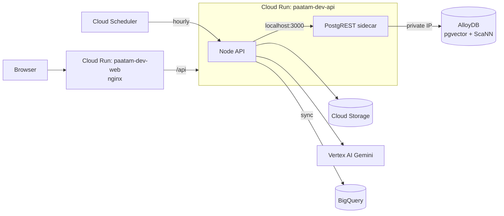

# Paatam.ai on Google Cloud: runbook

The working demo (`smartstudy-backend` + `smartstudy-frontend`) runs on Google Cloud with:

| Piece | Service |
|---|---|
| Database (tables, SQL functions, pgvector embeddings) | **AlloyDB for PostgreSQL**, with a **ScaNN** vector index |
| Data API used by the backend (same `supabase.from(...)` calls as before) | **PostgREST** sidecar inside the API's Cloud Run service (private, localhost only) |
| Backend API | **Cloud Run** `paatam-dev-api` |
| Web app | **Cloud Run** `paatam-dev-web` (nginx, proxies `/api` to the API) |
| Uploaded answer sheets, question papers, answer keys, diagrams | **Cloud Storage** (private bucket; files served via `GET /api/files/...`) |
| OCR, evaluation, exam generation, embeddings, diagrams | **Vertex AI Gemini** (service account, no API key) |
| Campus analytics (Principal Dashboard) | **BigQuery** dataset `paatam_dev_analytics`, synced from AlloyDB hourly (Cloud Scheduler) and on demand |
| Secrets | **Secret Manager** |



## Runs next to other Paatam resources

Everything this replica creates is prefixed `paatam-dev` (`APP` in `infra/config.sh`), so it can share a project with an earlier deployment without replacing it:
- Cloud Run `paatam-dev-api` / `paatam-dev-web`;
- service accounts `paatam-dev-api` / `paatam-dev-deployer`;
- secrets `paatam-dev-*`;
- database `paatam_dev` with superuser `paatam_dev_admin`;
- BigQuery `paatam_dev_analytics`;
- bucket `<project>-paatam-dev-uploads`;
- Artifact Registry `paatam-dev`.

If the AlloyDB cluster `paatam-cluster` already exists, it is reused: a new database and user are added, and existing databases, users and network peering are left unchanged.

## Deploy (Cloud Shell, about 45 minutes, mostly AlloyDB creation)

```bash
git clone -b gcp https://github.com/PAATAM-AI/Paatam.git && cd Paatam
```

```bash
export PROJECT=267947667128          # project number or id
```

```bash
bash infra/setup.sh
```

```bash
bash infra/migrate-db.sh             # asks for the Supabase connection string (hidden input)
```

```bash
bash infra/deploy.sh
```

- `setup.sh` turns on the services and creates the service account, AlloyDB (cluster + primary), private networking, the bucket, the BigQuery dataset, Artifact Registry and generated secrets. Re-running it is safe.
- `migrate-db.sh` copies schema `public` (tables, functions, data) from Supabase into AlloyDB, prints row counts side by side, creates the PostgREST roles and adds the ScaNN index.
  - Get the connection string from **Supabase → Connect → Session pooler → URI**, with the database password filled in.
  - No Supabase any more? Run `bash infra/migrate-db.sh --from-code` to create an empty schema instead.
- `deploy.sh` builds both images with Cloud Build and deploys the API (with the PostgREST sidecar) and the web app. It also schedules the BigQuery sync and runs smoke tests, then prints the web URL.

To redeploy after code changes, run `bash infra/deploy.sh` again.

## Settings you may change (environment variables before running the scripts)

| Variable | Default | Notes |
|---|---|---|
| `REGION` | `asia-south1` | AlloyDB, Cloud Run, bucket, BigQuery |
| `GEMINI_MODEL` | `gemini-2.5-flash` | Must be callable on Vertex AI in your project; check `/api/test-models` |
| `GEMINI_IMAGE_MODEL` | `gemini-2.5-flash-image` | Diagram generation |
| `VERTEX_LOCATION` | `global` | Use `us-central1` if a model is not offered globally |
| `ALLOYDB_CPUS` | `2` | Smallest primary |

Every Gemini text call (OCR, evaluation, exam generation) uses `GEMINI_MODEL`; diagrams use `GEMINI_IMAGE_MODEL`; embeddings use `gemini-embedding-001` (1536 dimensions, as before).

Optional provider keys (Sarvam for Hindi/Telugu, Meta WhatsApp) are picked up by `deploy.sh` if these secrets exist: `paatam-dev-sarvam-api-key`, `paatam-dev-meta-whatsapp-token`, `paatam-dev-meta-phone-number-id`. `setup.sh` prints the commands to create them, with the value typed hidden.

## Showcase checklist

1. **Exam generation (Vertex AI + AlloyDB vectors):** Knowledge Base → upload a textbook chapter → Exam Generator → generate a paper.
2. **Evaluation:** open a class subject workspace and upload the question paper, then the answer key, then deploy. Scan & Grade → upload answer sheets → Review Queue → approve.
3. **Analytics (BigQuery):** open Principal Dashboard → **Sync from AlloyDB & Refresh**. The page reads only from BigQuery views.
4. Optional, in the BigQuery console: `SELECT * FROM paatam_dev_analytics.v_subject_performance`.

## Notes and limits

- Cloud Run accepts request bodies up to **32 MiB**, so split very large scanned PDFs.
- The database-reset endpoint (`DELETE /api/clear`) is **off** in this deployment (`ALLOW_DB_RESET=false`).
- **Login check:** the demo's login checks the email only, not the password, and that's unchanged here. Fix it before real users.
- **Logs:**

  ```bash
  gcloud run services logs read paatam-dev-api --region=asia-south1 --limit=100
  ```
